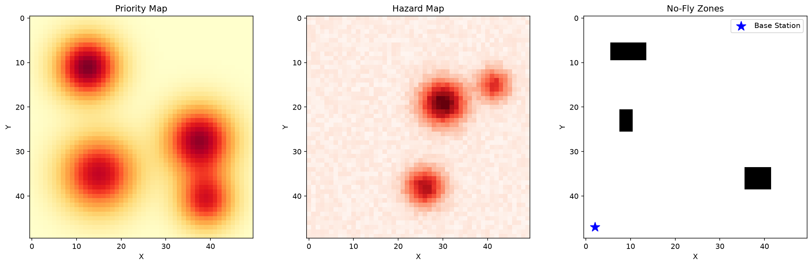
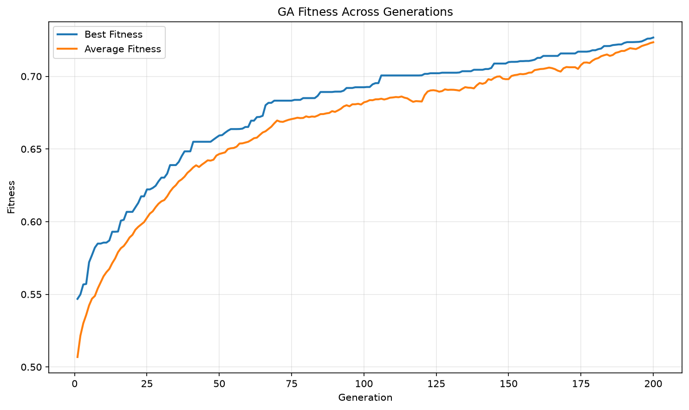

# uav-genetic-algorithm
# UAV Route Optimization Using a Genetic Algorithm

## Project Description

This project implements a Genetic Algorithm (GA) to optimize routes for Unmanned Aerial Vehicles (UAVs). The algorithm searches for high-quality routes while considering environmental factors such as priority regions and no-fly zones. It uses genetic algorithm operations, including selection, crossover, and mutation, to improve route fitness over multiple generations. The project also compares the Genetic Algorithm with Random Search and provides visualizations of routes, fitness history, convergence, and parameter sensitivity.

## Features

- UAV environment simulation with priority regions and no-fly zones.
- Genetic Algorithm for route optimization.
- Random Search baseline for performance comparison.
- Fitness and convergence visualization.
- Sensitivity experiments for population size, mutation rate, and tournament size.
- Saved plots and experimental results.

## Installation

1. Clone or download this repository.
2. Open the project folder in VS Code.
3. Open the terminal in the project directory.
4. Install the required dependencies:

```bash
pip install -r requirements.txt
```

## How to Run

### Run the Main Project

Execute the following command from the project root directory:

```bash
python main.py
```

This runs the Genetic Algorithm and Random Search baseline, displays the results in the terminal, and saves the generated visualizations in the `results/` directory.

### Run Sensitivity Experiments

Execute:

```bash
python experiments/sensitivity.py
```

This script evaluates different Genetic Algorithm parameter settings using multiple random seeds. The results are used to analyze how population size, mutation rate, and tournament size affect optimization performance.

The experiment results and plots are saved in the `results/` directory, depending on the script configuration.

## Project Structure

```text
uav-genetic-algorithm/
│
├── src/
│   ├── __init__.py
│   ├── environment.py
│   ├── chromosome.py
│   ├── fitness.py
│   ├── operators.py
│   ├── ga.py
│   ├── baseline.py
│   └── visualize.py
│
├── experiments/
│   └── sensitivity.py
│
├── results/
│   ├── environment.png
│   ├── best_routes.png
│   ├── fitness_history.png
│   ├── ga_vs_random.png
│   └── sensitivity.csv
│
├── config.py
├── main.py
├── requirements.txt
└── README.md
```

*Note: The files shown in the results folder are expected outputs; their exact names depend on the plotting and experiment scripts.*

## Configuration Options

The `config.py` file contains the project's configurable settings. Depending on the options defined in that file, these may include:

- **Environment settings:** Grid dimensions, priority regions, and no-fly zones.
- **Population size:** Number of candidate routes maintained in each generation.
- **Generations:** Maximum number of evolutionary iterations.
- **Mutation rate:** Probability of applying mutation to a candidate solution.
- **Tournament size:** Number of candidates considered during tournament selection.
- **Elite size:** Number of top solutions preserved between generations.
- **Patience:** Number of generations without improvement before early stopping.
- **Random seed:** Controls random-number generation to help make experiments reproducible.

Update the relevant values in `config.py` or the experiment script to test different configurations. The exact settings used by the algorithm depend on how the configuration values are connected to the source code.

## Results and Visualizations

### UAV Environment



This visualization shows the simulated environment, including priority areas and restricted flight regions.

### Fitness History



This graph shows how the best and average fitness values change across generations, helping evaluate the Genetic Algorithm's progress.

## Technologies Used

- Python
- Genetic Algorithms
- NumPy
- Matplotlib
- Random Search
- Data visualization

## Author

Developed as a UAV route optimization project using evolutionary computation techniques.